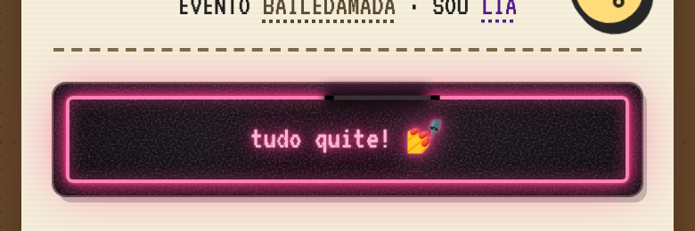
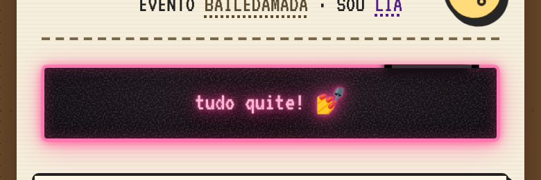

# neon em fundo escuro

referência pro modo escuro com tema neon (#285): as duas versões do "tudo quite" em fundo escuro que passaram pela `main`
antes de ele voltar pro papel. O comportamento (acende engasgando, falhas sorteadas, o trecho queimado indo e voltando)
é o mesmo do que está no ar hoje e mora no `app.js` (o neon do quite: `luzNeon`, `neonAnda`, `queima()`). Aqui só
muda o CSS.

## QT · placa escura, tubo por dentro

uma plaquinha escura e encardida colada no papel, com o tubo afastado da borda (`::before` com inset 7px) e o brilho
vazando em volta. Esteve no ar no #283 (commit `b96288f`).



```css
/* conta fechada: plaquinha escura e encardida colada no papel, com um tubo de neon rosa por dentro. A luz vem do app.js
   (o neon do quite), de 0 a 1 e acima no estalo: --luz no tubo, --luzT no letreiro. Apagado, o vidro fica no --apagado;
   sem ela, aceso parado */
.empty.vazio.quite{--neon:#ff3d8f;--apagado:#4a3e44;--luz:1;--luzT:1;position:relative;isolation:isolate;border:0;border-radius:7px;padding:18px 20px;
  --tubo:color-mix(in srgb,var(--neon) calc(var(--luz)*100%),var(--apagado));
  --tuboT:color-mix(in srgb,var(--neon) calc(var(--luzT)*100%),var(--apagado));
  background:url("data:image/svg+xml,%3Csvg xmlns='http://www.w3.org/2000/svg' width='180' height='180'%3E%3Cfilter id='n'%3E%3CfeTurbulence type='fractalNoise' baseFrequency='.85' numOctaves='3' stitchTiles='stitch'/%3E%3CfeColorMatrix values='0 0 0 0 1 0 0 0 0 1 0 0 0 0 1 .35 0 0 0 -.15'/%3E%3C/filter%3E%3Crect width='100%25' height='100%25' filter='url(%23n)'/%3E%3C/svg%3E"),radial-gradient(ellipse at 50% 40%,#221a21,#120d12 80%);
  box-shadow:inset 0 1px 0 rgba(255,255,255,.07),0 0 0 1px rgba(0,0,0,.55),3px 4px 0 rgba(0,0,0,.2),0 0 calc(30px*var(--luz)) color-mix(in srgb,var(--tubo) 28%,transparent);
  color:color-mix(in srgb,#fff calc(var(--luzT)*62%),var(--tuboT));
  text-shadow:0 0 1px rgba(255,255,255,calc(var(--luzT)*.5)),0 0 4px var(--tuboT),0 0 calc(12px*var(--luzT)) var(--tuboT),0 0 calc(24px*var(--luzT)) color-mix(in srgb,var(--tuboT) 55%,transparent)}
.empty.vazio.quite b,.empty.vazio.quite .nm{color:inherit !important}
.empty.vazio.quite::before{content:'';position:absolute;inset:7px;z-index:-1;border-radius:4px;pointer-events:none;
  border:2px solid color-mix(in srgb,#fff calc(var(--luz)*35%),var(--tubo));
  box-shadow:0 0 2px var(--tubo),0 0 calc(9px*var(--luz)) var(--tubo),0 0 calc(20px*var(--luz)) color-mix(in srgb,var(--tubo) 50%,transparent),inset 0 0 calc(9px*var(--luz)) color-mix(in srgb,var(--tubo) 45%,transparent)}
/* o trecho queimado: um pedaço do tubo apagado, com as pontas pretas do eletrodo e o brilho em volta engolido, que
   escorrega pelo topo, desce um pouco o canto e volta. O svg fica no meio do tubo (inset 8px); pathLength 100 */
.queima{position:absolute;inset:8px;width:calc(100% - 16px);height:calc(100% - 16px);overflow:visible;pointer-events:none;z-index:-1}
.queima rect{fill:none;stroke-dasharray:9 91;stroke-dashoffset:-18;animation:vaivem 16s ease-in-out infinite alternate}
.queima .q-sombra{stroke:#150f15;stroke-width:12;filter:blur(3px);stroke-dasharray:8 92}
.queima .q-vidro{stroke:#3a3236;stroke-width:2.4}
.queima .q-ponta{stroke:#000;stroke-width:2.6;stroke-dasharray:.7 7.6 .7 91}
@keyframes vaivem{from{stroke-dashoffset:-2}to{stroke-dashoffset:-34}}
@media (prefers-reduced-motion:reduce){.queima rect{animation:none}}
```

## PT · caixa escura, tubo na borda

a caixa inteira vira o miolo escuro e a borda é o tubo. O trecho queimado anda pelo meio da borda, com a sombra presa
do lado de dentro pelo `clip-path`. Mergeada no #284 (commit `dcd934a`); o deploy dela falhou no Pages e ela não chegou ao ar.



```css
/* conta fechada: a caixa vira um miolo escuro e encardido, e a borda é o tubo de neon rosa. A luz vem do app.js (o neon
   do quite), de 0 a 1 e acima no estalo: --luz no tubo, --luzT no letreiro. Apagado, o vidro fica no --apagado; sem ela,
   aceso parado */
.empty.vazio.quite{--neon:#ff3d8f;--apagado:#4a3e44;--luz:1;--luzT:1;position:relative;isolation:isolate;
  --tubo:color-mix(in srgb,var(--neon) calc(var(--luz)*100%),var(--apagado));
  --tuboT:color-mix(in srgb,var(--neon) calc(var(--luzT)*100%),var(--apagado));
  border:2px solid color-mix(in srgb,#fff calc(var(--luz)*30%),var(--tubo));
  background:url("data:image/svg+xml,%3Csvg xmlns='http://www.w3.org/2000/svg' width='180' height='180'%3E%3Cfilter id='n'%3E%3CfeTurbulence type='fractalNoise' baseFrequency='.85' numOctaves='3' stitchTiles='stitch'/%3E%3CfeColorMatrix values='0 0 0 0 1 0 0 0 0 1 0 0 0 0 1 .35 0 0 0 -.15'/%3E%3C/filter%3E%3Crect width='100%25' height='100%25' filter='url(%23n)'/%3E%3C/svg%3E"),radial-gradient(ellipse at 50% 40%,#221a21,#120d12 80%);
  box-shadow:0 0 1px var(--tubo),0 1px calc(8px*var(--luz)) color-mix(in srgb,var(--tubo) 80%,transparent),0 4px calc(22px*var(--luz)) color-mix(in srgb,var(--tubo) 40%,transparent),inset 0 0 calc(9px*var(--luz)) color-mix(in srgb,var(--tubo) 30%,transparent);
  color:color-mix(in srgb,#fff calc(var(--luzT)*62%),var(--tuboT));
  text-shadow:0 0 1px rgba(255,255,255,calc(var(--luzT)*.5)),0 0 4px var(--tuboT),0 0 calc(12px*var(--luzT)) var(--tuboT),0 0 calc(24px*var(--luzT)) color-mix(in srgb,var(--tuboT) 55%,transparent)}
.empty.vazio.quite b,.empty.vazio.quite .nm{color:inherit !important}
/* o trecho queimado: um pedaço do tubo apagado, com as pontas pretas do eletrodo e o brilho de dentro engolido, que
   escorrega pelo topo, desce um pouco o canto e volta. O svg fica no meio da borda (inset -1px) e o clip guarda a sombra
   do lado de dentro, senão ela sujava o papel; pathLength 100 */
.queima{position:absolute;inset:-1px;width:calc(100% + 2px);height:calc(100% + 2px);overflow:visible;pointer-events:none;z-index:-1;clip-path:inset(-1.4px round 5px)}
.queima rect{fill:none;stroke-dasharray:9 91;stroke-dashoffset:-18;animation:vaivem 16s ease-in-out infinite alternate}
.queima .q-sombra{stroke:#120d12;stroke-width:12;filter:blur(3px);stroke-dasharray:8 92}
.queima .q-vidro{stroke:#3a3236;stroke-width:2.4}
.queima .q-ponta{stroke:#000;stroke-width:2.6;stroke-dasharray:.7 7.6 .7 91}
@keyframes vaivem{from{stroke-dashoffset:-2}to{stroke-dashoffset:-34}}
@media (prefers-reduced-motion:reduce){.queima rect{animation:none}}
```

## o que aprendemos

- no escuro o neon aparece muito mais e as falhas pesam: o apagão vira buraco preto de verdade.
- o letreiro claro (`#fff` misturado no rosa) com halo em camadas lê bem; no papel o texto precisa ir pro escuro.
- o trecho queimado engole o brilho com uma sombra da cor do fundo: no escuro ela é `#120d12`/`#150f15`, no papel
  `#fff8e6`.
- grão de ruído (`feTurbulence` em data URI, a CSP aceita `data:` em imagem) dá o encardido sem imagem nova.
